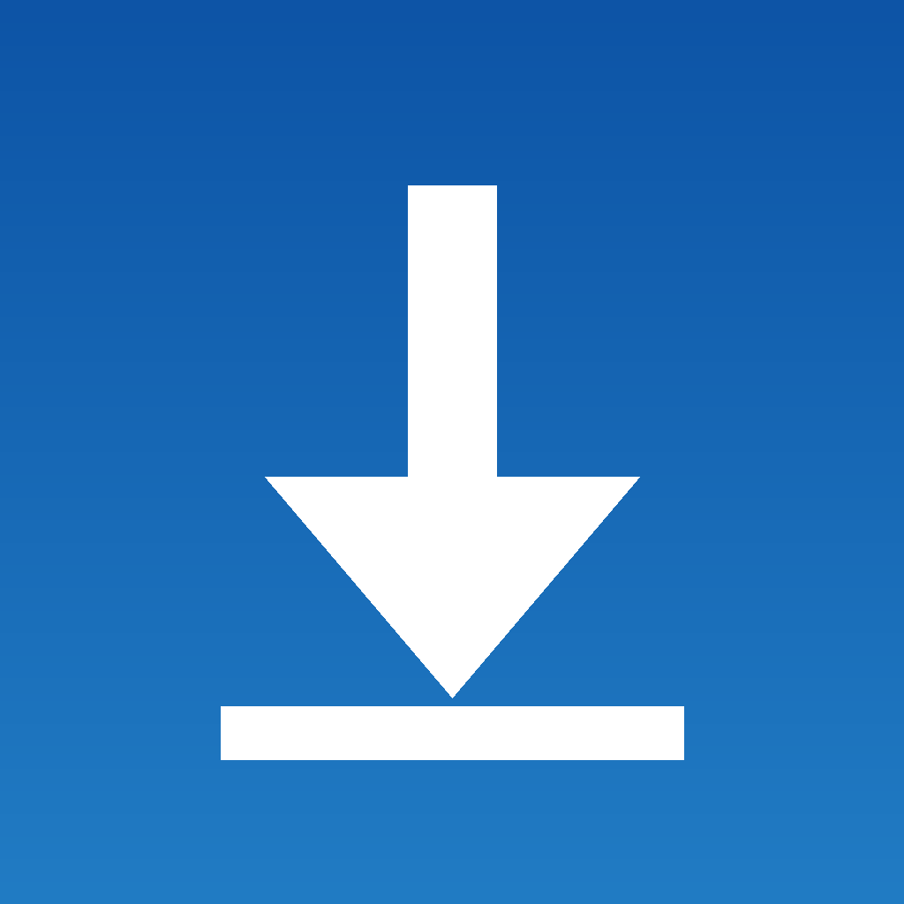

  

<h1 align="center">Downloader</h1>

A download manager for <b>iPhone</b> | parallel segmented downloads, a persistent queue, live speed and time remaining, and pause and resume that pick up right where they stopped.

  
  
  
  

  📥 <a href="https://github.com/c12n/downloader/releases/latest"><b>Download v1.0.0</b></a> · 🐛 <a href="https://github.com/c12n/downloader/issues"><b>Report an issue</b></a>

`v1.0.0` · First release | segmented downloads, a persistent queue, and live speed and ETA.

> [!NOTE]
> **Independent.** Downloader is an open-source app in the spirit of AB Download Manager. It is not affiliated with or endorsed by AB Download Manager or Apple Inc.

---

## 🌟 Features

| **Segmented downloads** When a server supports byte ranges, a file is split into parts and pulled down over parallel connections | 1 to 16, you choose (default 4). No range support? It falls back to a single stream automatically.  | **A queue that persists** Add one link or many at once. The queue, progress and resume data are saved on the device, so closing the app loses nothing.  |
| :--- | :--- |
| **Pause and resume** Pause anything, resume it later | even after a relaunch, a segmented download continues from the parts it already has instead of starting over.  | **Live speed and ETA** Every running download shows its current speed and time remaining, updated as it goes.  |
| **Files where you can see them** Finished downloads land in the app's `Documents/Downloads` folder, visible in the Files app, ready to open or share.  | **Your pace** Settings for connection count, how many downloads run at once, and a keep-awake switch for long pulls.  |

---

## 🚀 Installation

### iOS

**Sideload**

1. Download `Downloader.ipa` from the [latest release](https://github.com/c12n/downloader/releases/latest).
2. Install it with Feather, AltStore, SideStore, Sideloadly, or your preferred sideloading tool.
3. Updates are new IPAs from the same releases page; installing one over the old keeps your queue and files.

> [!TIP]
> The IPA is unsigned, so your sideloading tool signs it with your own certificate as part of the install.

---

## 📖 How to Use

1. **Add links:** paste one URL, or several at once, and add them to the queue.
2. **Let it run:** downloads start in order; watch speed and time remaining on each row, and pause or resume any of them.
3. **Get your files:** finished downloads are in the Files app under the Downloader folder, in `Downloads`.

---

## 🗺️ Roadmap

- **Background downloads** | a background URLSession so downloads keep going while the app is closed.
- **Share extension** | send a link to Downloader straight from Safari's share sheet.
- **Per-download connection counts** | override the global setting on a single file.

---

## ⚠️ Known Issues

- Downloads run on a foreground URLSession: iOS may suspend the app after it has been in the background for a while. Progress is persisted and resumes where it stopped when you come back.
- Servers that do not support byte ranges are downloaded in a single stream, so they will not get the segmented speed-up.

---

## ❓ FAQ

**Is it free?**
Yes | free, no ads, no in-app purchases.

**What links does it work with?**
Any direct link to a file. If the server supports byte ranges you get segmented speed; if not, the same link downloads in a single stream.

**Does it collect my data?**
No accounts, no analytics, no tracking, no ads. See the Privacy section below.

---

## 🔒 Privacy

Downloader collects nothing. There are no accounts, no analytics, no tracking and no ads. The only network traffic is the downloads you start, going to the servers behind the links you pasted. Your queue, settings and files stay on your device.

---

## 🏗️ Built With

- **SwiftUI** for the interface
- **URLSession** for the download engine, with a custom segmented (range) downloader on top
- **Swift** throughout | no third-party dependencies

---

## 🛠️ Build It Yourself

### iOS

1. Open `Downloader.xcodeproj` in Xcode.
2. Pick the `Downloader` target and build for an arm64 iOS device (iOS 17+).
3. For a sideload IPA, build with signing off and package the `.app` into a `Payload` folder, or let your sideloading tool handle it.

<b>Project layout</b>

- `Downloader/` | the app target: `ContentView` (queue interface), `DownloadManager` (queue, persistence, scheduling), `SegmentedDownloader` (parallel range downloads), `Models`, `SettingsView`, and the app icons
- `Downloader.xcodeproj` | the Xcode project
- Releases are built from this source and attached to the [GitHub releases](https://github.com/c12n/downloader/releases)

---

## Disclaimer

This is an unofficial open-source project and is not affiliated with, authorized, or endorsed by AB Download Manager or Apple Inc. Provided "as is", without warranty of any kind. Only download files you have the right to download.

- This app is **free**. If a third party charged you for it, you may have been misled.
- No user data is collected, stored, or distributed by this repository.

## 📄 License

MIT | Copyright (c) 2026 c12n Apps. See [LICENSE](LICENSE).

> [!TIP]
> **Star the repo** to get notified about new releases directly from GitHub.
